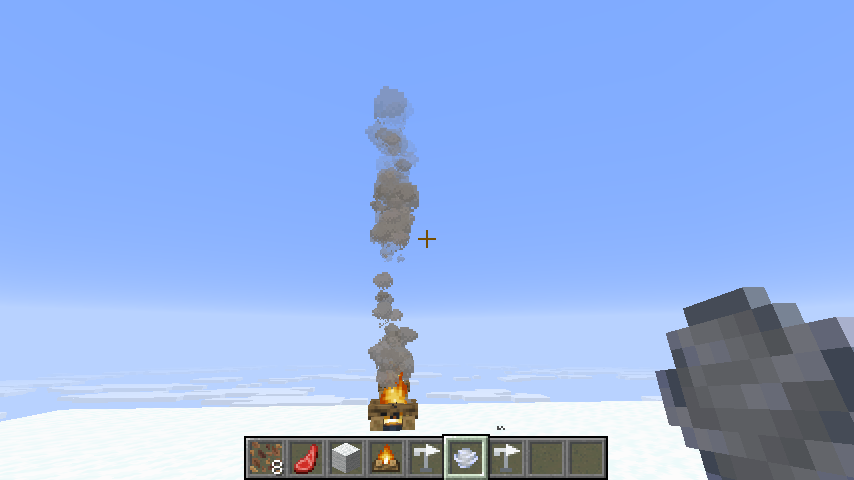
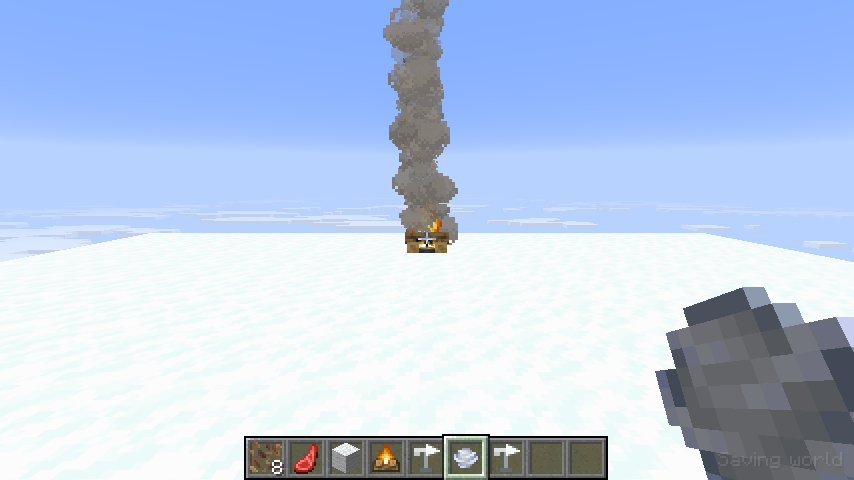
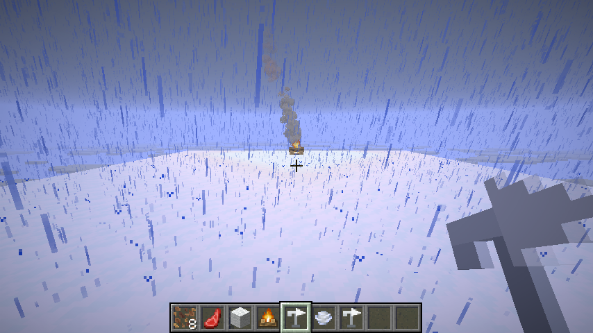
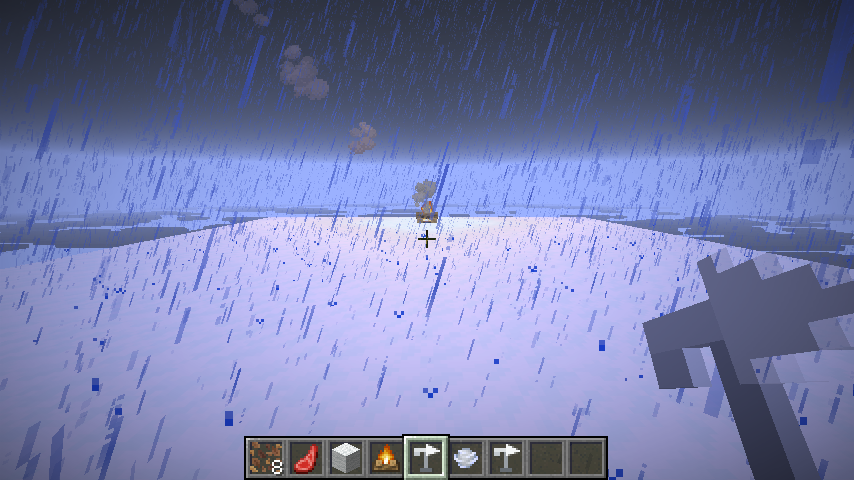

# Must've Been the Wind


**A living wind system for Minecraft Fabric.** Campfire smoke bends downwind, rain and snow slant,
clouds drift across the sky, and sudden gusts roll through even the calmest day.

> Named after the oldest excuse in gaming.



## Features

### Weather-aware wind
Wind is not a single global effect. It changes with the weather and the time of day:

| Conditions | Wind strength |
|---|---|
| Clear day | 2–8% |
| Clear dawn/dusk | 1.5–6.5% |
| Clear night | 1–5% |
| Rain, day | 25–50% |
| Rain, night | 28–55% |
| Thunderstorm, day | 80–100% |
| Thunderstorm, night | 85–100% |

The bands blend smoothly as rain and thunder build or fade. Direction wanders on its own, and strong
wind swings farther than a light breeze.

### Gusts, lulls, squalls and gust fronts
The background wind is punctuated by short events. They arrive on their own schedule, weighted by the
weather, and have a smooth attack, hold and release:

| Event | Duration | Effect |
|---|---:|---|
| Breeze | 8–14 s | A gentle rise |
| Gust | 3–5 s | A quick push above the background wind |
| Lull | 3–6 s | A sudden drop, even during a storm |
| Squall | 5–9 s | A strong push with a direction veer |
| Gust front | 8–14 s | The strongest push, with the biggest veer |

Rain begins with a squall. A thunderstorm arrives with a gust front. A slow multi-minute cycle also
makes long storms rise, peak and fall instead of sitting at one speed.

### Smoke, clouds and precipitation
- Campfire smoke inherits the wind, so plumes bend and trail downwind. Signal fires work too.
- Clouds drift with the wind instead of using vanilla's fixed eastward motion.
- Rain and snow columns lean downwind, with the slant growing as the wind strengthens.
- Hostile mobs downwind of a lit campfire can investigate the smoke (experimental).

### Wind-reactive world
The wind does not stop at smoke. Grass, ferns, flowers, crops, saplings, nether plants and berry bushes
bend downwind, with a light flutter on top. Hanging lanterns swing below their chains, and banner cloth
flaps harder as the wind rises. The block set is data-driven: packs can extend
`windsmoke:wind_sensitive` and `windsmoke:wind_hanging`.

### Wind Vane
The Wind Vane is a placeable survival sensor. Craft one from three copper ingots, a redstone dust and
a stick:

```text
 C
CRC
 S
```

`C` = copper ingot, `R` = redstone dust, `S` = stick.

The copper arrow turns with the live wind. Right-click a placed vane for a direction and strength
readout. It also has an optional comparator output: by default the comparator signal is the wind's
16-point direction (`0` = north, `4` = east, `8` = south, `12` = west). Sneak-use the vane to toggle
the comparator output on or off. The vane is also available in the Redstone Blocks creative tab.

## Commands

| Command | Description |
|---|---|
| `/wind` | Show the current wind, weather/time band and active event |
| `/wind set <degrees> <strength>` | Pin the wind. `0` = north, `90` = east, `180` = south, `270` = west |
| `/wind auto` | Release a pinned wind back to natural weather |
| `/wind event <breeze\|gust\|lull\|squall\|front>` | Trigger a wind event immediately |

`/wind event` also releases a pinned wind so the event can take effect.

## Performance and settings

The client settings screen (Mod Menu, or `F8`) controls visual intensity, wind effect distance, visual
quality and smoke density. The distance setting covers vegetation, banners and smoke visuals; it does
not change the server-authoritative wind. Server-side campfire smoke attraction can be toggled with
`/wind smoke <true|false>` and is also stored in `config/windsmoke-server.json`.

While in a world, the settings screen also has a **Wind controls…** button. It opens sliders for wind
direction and intensity and an Apply button, so operators can test wind states without typing
commands. Changes are still server-authoritative and require operator permission on multiplayer
servers. **Release to weather** returns the wind to its natural cycle.

Banner cloth uses a fixed-step simulation only near the camera, with a bounded number of full-quality
simulations and a coarse static grid for distant banners. Pattern layers share the same per-frame
positions and normals.

## Sodium compatibility

Sodium **0.9.2+mc26.2** is supported as an optional client integration. When Sodium is installed,
Must've Been the Wind patches Sodium's terrain shader at runtime and tags Sodium's chunk vertices, so
grass, flowers, crops, leaves and hanging lanterns sway under Sodium's renderer too. Vanilla and
Fabric Indigo are supported as separate paths; Indigo bypasses the vanilla model renderer, so its
quads are tagged through Indigo's `AltModelBlockRendererImpl` instead.

The integration is client-side and version-specific. The 1.21.11 branch supports Sodium
**0.8.7+mc1.21.11**; this 26.2 branch targets Sodium **0.9.2+mc26.2**. Iris shader packs are not
covered yet. Sodium's Vulkan backend is untested; the current integration targets OpenGL.

## Requirements

| | |
|---|---|
| Minecraft | 26.2 |
| Fabric Loader | 0.19.5 or newer |
| Fabric API | 0.161.0+26.2 or newer |
| Java | 25 or newer |
| Sodium (optional) | 0.9.2+mc26.2 (tested) |

Install the mod on both the client and server. The server owns the wind state; the client uses it for
the visual effects.

## Installation

1. Install Fabric Loader for Minecraft 26.2.
2. Download [Fabric API](https://modrinth.com/mod/fabric-api) for 26.2.
3. Put both `fabric-api-*.jar` and `mustve-been-the-wind-*.jar` into your `mods` folder.
4. Launch the Fabric profile.

## Screenshots

| Calm day | Gust front |
|---|---|
|  |  |

| Rain | Thunderstorm |
|---|---|
|  |  |

## Building from source

You need JDK 25 or newer. The Gradle wrapper handles the rest.

```bash
git clone https://github.com/AkSinghSidhu/mustve-been-the-wind.git
cd mustve-been-the-wind
./gradlew build
```

The mod jar is written to `build/libs/mustve-been-the-wind-0.1.0+26.2.jar`.

For a normal development client:

```bash
./gradlew runClient
```

## How it works

- `WindState` keeps the live wind on the server: a direction, a strength, weather/time bands, a slow
  background cycle and transient events.
- The wind is synced to clients four times per second with a small custom payload, so short gusts are
  visible in particles, clouds and weather.
- Client mixins redirect the campfire smoke spawn, offset the cloud renderer, shear precipitation
  vertices for the wind lean, and nudge plant and hanging-block vertices.
- With Sodium, the same wind tags are written into Sodium's packed chunk vertices and the displacement
  is injected into Sodium's terrain shader. Sodium's region offset is camera-relative, so the shader
  reconstructs the world position before sampling the wind field.
- Banner flags use their render-state animation phase plus the live wind to flap harder in a storm.
- The wind vane's arrow is drawn by a block entity renderer; its 16-way block state supplies the
  comparator direction signal.
- The technical mod ID is `windsmoke`; the block and item are `windsmoke:wind_vane`.

## License

This project is released under [CC0-1.0](LICENSE). Do whatever you like with it.

Built with [Fabric](https://fabricmc.net/).
